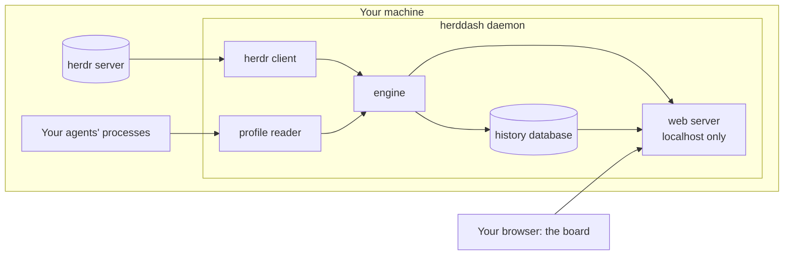
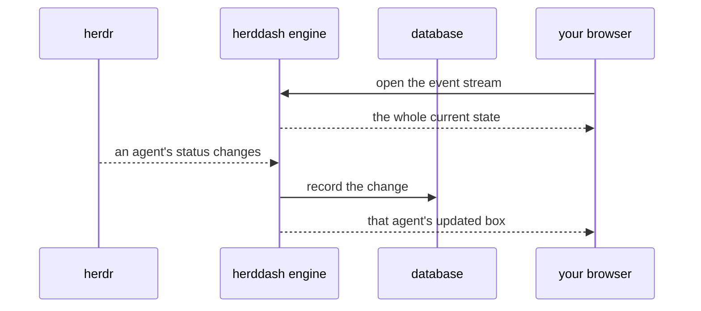

# How herddash works

This is how herddash works, written for herdr users deciding whether to run it. The code is the
authority; this page is kept in step with it.

## What it is for

You run several AI coding agents in [herdr](https://herdr.dev). One finishes, or stops to ask you
a question, while you are looking at another pane. herdr can tell you with a desktop notification,
but that notification is suppressed for the tab you are looking at, needs an attached terminal,
and is gone in seconds.

herddash is a page you keep open in a browser window beside your terminal. It shows one box per
agent. Agents blocked on a question come first, then agents that have finished, each with the
longest-waiting at the top. Each box says which profile the agent runs under, so two `claude` panes
on different subscriptions are told apart. It also says how long the agent has been waiting. That
figure comes from a recorded history and survives restarts.

It changes nothing in herdr. It has no terminal, no prompt box, and no way to focus, close or type
into a pane; herdr already does those. Its one control is herddash's own note that you have read a
finished agent's result, **Seen** (below). For a full browser client, see
[devswha/herdr-web-ui](https://github.com/devswha/herdr-web-ui), which herddash is designed to run
beside.

## The pieces

herddash is one program, the **daemon**, that you run on the machine where herdr runs.

- **The herdr client** holds its own connection to herdr's socket and subscribes to every agent's
  status. It sees every change whether or not you have a terminal attached.
- **The profile reader** works out which profile each agent runs under. For Claude Code it reads
  `CLAUDE_CONFIG_DIR` from the agent's process environment and maps it to a name you choose in the
  config file. Other agent programs show their program name until a rule for them is added. A
  lookup that times out or that herdr fails to answer is tried again a few times; until one
  succeeds, a new agent shows `unresolved` and a known one keeps the profile it had. While a known
  agent's profile is worked out again, after its program changes or herdr detects it anew, its
  new status changes wait, a few seconds at most, so each is recorded with the right profile.
- **The engine** is the one part that holds the current state and writes to the database. Everything
  else goes through it, so no two parts can disagree about an agent's state.
- **The history database** is a SQLite file. It records every status change, which profile owned
  the agent at the time, and where the record came from. Old records are deleted after 90 days by
  default.
- **The web server** serves the board, a small API and a live event stream, and listens only on
  your own machine. Every route only reads, except the four that record a Seen, which accept a
  request only from the board's own page.

## How a change reaches your screen

When you open the board, the page subscribes to the event stream, and the first thing it receives
is the whole current state. After that each change arrives as it happens, within about a second.
If the connection drops, the page reconnects and receives the whole state again, so it cannot drift.
The stream also sends a keepalive every 15 seconds, so a daemon that hangs with the connection
still open is noticed too: after 35 seconds of silence the page dims, says it has lost contact and
reconnects. These timings, and the daemon's own ones for talking to herdr, are fixed; the end of
[the configuration example](config.example.toml) lists them.

herddash never asks herdr for anything when you load the page. The page shows herddash's own
record, so a dozen open tabs put no extra load on herdr.

The API also answers what one agent did. `GET /api/agents/{host}/{server}/{epoch}/{pane}/history`
returns `{"key": …, "transitions": [ … ]}`: every recorded status change of that agent, oldest
first, each with the profile at the time and where it came from (`live`, `snapshot` or
`backfill`). Each part of the path is percent-encoded, so pane `w1:p1` may be sent as `w1%3Ap1`.
A 404 means herddash holds no record for that agent: it was never seen, or its records are older
than the retention period and have been deleted. Retention never deletes the change that started
an agent's current state, so an agent on the board always has at least that row. The body also
carries `acknowledgements`: the agent's Seen marks and their undos, in the order they were made,
each `{"finished_since", "seen", "observed_at"}` (`[]` when there are none).

## Marking a finished agent Seen

A finished agent stays finished until its next turn, however long ago you read its result. So each
finished box carries a `✓ Seen` button. Press it once you have read the result, and the box turns
grey, is labelled SEEN, moves down among the idle boxes of its workspace, and leaves the
workspace's finished count, which lists it as `N seen` instead. A workspace heading with two or
more unseen finished boxes offers `✓ Mark N finished seen`, which marks exactly the boxes it shows.
For six seconds after each mark an Undo bar lets you take it back. There is no keyboard shortcut;
the controls are ordinary buttons, so a keyboard-navigation extension such as Vimium reaches them.

What a Seen mark does:

- It names one exact finish: the agent and the moment its current finish began, the
  `waiting_since` the API sends. A button pressed on a box that has since moved on is refused, and
  nothing is marked.
- It lasts until the agent's next change out of that finish: a new turn, a question for you, a new
  agent in the pane, or a herdr restart. herdr's own `done` to `idle`, which happens when you look
  at the pane in herdr, keeps it, because that is the same finish. A whole turn herddash did not
  see (herddash stopped while the agent ran again, or events lost on the way) also ends it when
  herdr's change counter shows the status changed and came back: herddash notes herdr's counter
  with each mark and compares it with what herdr reports later. It cannot tell when no snapshot
  had read the counter for that finish, which is the case for up to a minute after a finish it
  learnt from a live event.
- It is recorded in the history database as a row of its own, and an undo is a further row, so it
  survives a restart of herddash and shows in the agent's history. There is no setting that turns
  recording off, but if herddash cannot load its saved state at start it records nothing for that
  run (and logs why); marking is then refused, because a mark it could not keep is not one.
- It reaches every open board through the event stream, as that agent's updated box.

What it does not do:

- **It never tells herdr.** herdr's own seen state, the status it reports and every other herdr
  client are unchanged; herddash makes no call to herdr for it at all.
- It changes no recorded status. The agent's class stays `finished` in the API, beside
  `"seen": true`; only its place on the board and its colour change.
- A box that needs you, or is idle, working or running background work, cannot be marked.

## Why the waiting time can be trusted

Every box shows how long the agent has been in its current state. herddash records the moment it
saw each change, so "waiting 40 minutes" is a recorded fact. A restart of herddash or of herdr does
not reset it.

When herddash did not see the moment itself, it does not invent one. That happens on the first
start, or when an agent changed while herddash was stopped. The box then shows a lower bound, such
as `≥ 12m`. History imported from an older herdr plugin is kept as history only and never sets a
live box's time.

## What it will never do

- **Never focus a pane.** herdr marks a finished agent as seen when it is focused. herddash's herdr
  client has no focus function at all, so it cannot clear a completion you have not looked at.
- **Never read pane output.** No excerpts, no scrollback. The client has no output-reading function,
  so prompts and secrets on your screen never reach herddash's database.
- **Never accept a change over the web but an acknowledgement, and only from its own page.** Every
  route only reads, except the four `POST` routes that mark or unmark Seen. Those accept a request only
  when it names localhost, carries the board's own origin, the header `X-Herddash-Write: 1` and a
  small JSON body; herddash answers no cross-origin preflight, so another web page you visit
  cannot send one. A Seen mark is the only thing they can change.
- **Never listen beyond your machine.** It binds to localhost, refuses to start on any other address
  until authentication exists, and rejects requests that do not name localhost. That last check
  stops a malicious web page from reading it through DNS tricks.
- **Never install itself into herdr.** It is not a herdr plugin and does not edit herdr's
  configuration.

## Where things live, and what it needs

| What | Where |
| --- | --- |
| Config file | `~/.config/herddash/config.toml` |
| History database, lock and log | `~/.local/share/herddash/` (or `$XDG_DATA_HOME/herddash`), readable only by you |
| The board | `http://localhost:<port>/` |

It ships as a single binary for macOS (Apple silicon or Intel) and Linux (Intel/AMD or ARM). It
needs no runtime, no package manager and no root, and it requires herdr 0.9.5 or newer.

## Limits of the first version

- **One machine.** Run one daemon per machine. A view across several machines can be added later:
  it would read each daemon's API, and every record already carries its machine's name.
- **A browser on the same machine only.** There is no phone access until authentication is designed.
- **Profiles for Claude Code only.** Codex and Antigravity show their program name until their
  profile signal is known.
- **Context Lines for Claude Code only.** A box's one-line context comes from the title the agent
  program sets on its pane, by a rule per program. For Claude Code it is the session's name; its
  placeholder title `Claude Code` and an empty title show nothing. Every other program shows
  nothing until it has a rule. Adding one is a single entry in the rule table in
  `internal/core/view.go`; the board and the API need no change.

## For contributors

The binding design rules are the
[architecture spine](planning/architecture/architecture-herddash-2026-10-14/ARCHITECTURE-SPINE.md).
The decisions behind them are [ADR-0004 to ADR-0014](adr/README.md), acknowledgement being
[ADR-0014](adr/0014-acknowledging-a-finished-agent.md), and what herddash must do is
the [PRD](prd.md).
