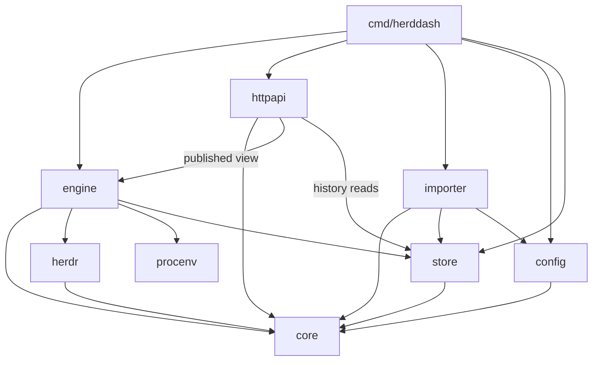
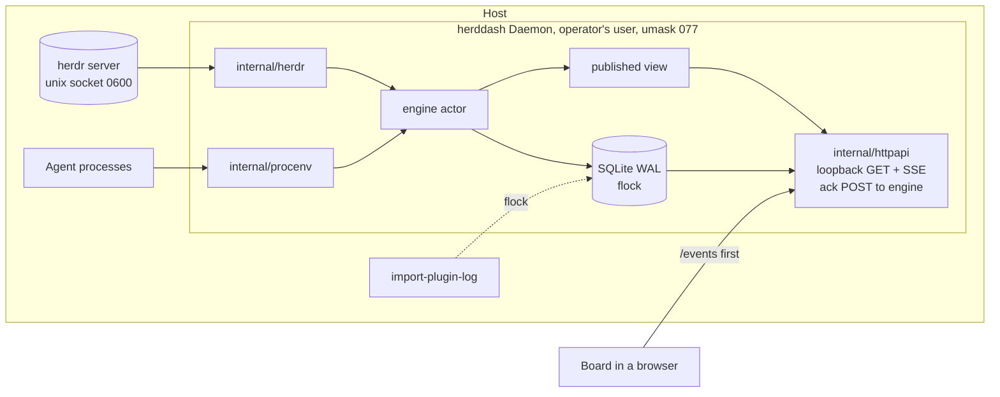
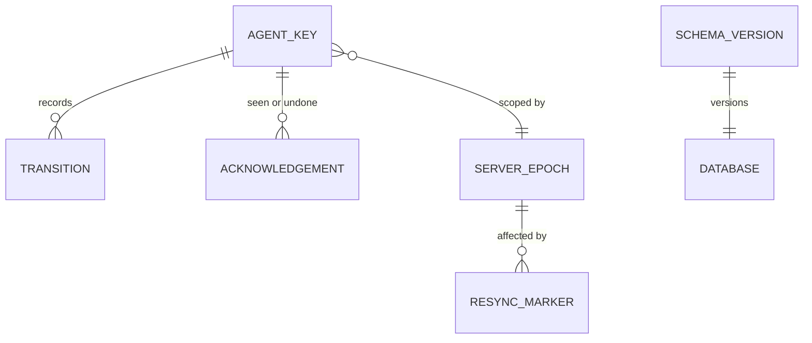

# Architecture Spine — herddash

Vocabulary is the PRD's §3 Glossary, used exactly. Where an `AD` cites an ADR, the ADR is the
authority and the `AD` states only what a builder must obey.

## Design Paradigm

**Hexagonal, with one actor.** A pure **core** holds every domain rule and does no I/O. **Adapters**
touch the outside world: the herdr socket, process environments, SQLite, HTTP, and the plugin log.
One **engine** goroutine is the only owner of current state and the only caller of store writes.

| Layer | Package | Holds |
| --- | --- | --- |
| Core | `internal/core` | AgentKey, Agent, Transition and its constructor, Status, Attention Class, Waiting Time and exactness, sort key, history fold, Profile and Context Line rules, AgentView, ConnectionTruth; Acknowledgement, its constructor and the rule deciding whether a finish is Seen (ADR-0014) |
| Engine | `internal/engine` | the actor: pane set, current state, reconcile and Retention timers, resync decisions, publishing views |
| Adapter | `internal/herdr` | socket mechanics: dial, ping, snapshot, subscribe, stream-health signals, generated wire types |
| Adapter | `internal/procenv` | reading one process's environment, and its direct children with their arguments (linux: `/proc`; darwin: `kern.procargs2`, `kern.proc.all`; children added 2026-10-21 for Background); and Claude Code's session record for one process, exactly `<config dir>/sessions/<pid>.json`, decoding only `pid`, `status` and `statusUpdatedAt` (added 2026-10-21, ADR-0008: a second source of `blocked`, recorded as `observed_by = claude_session`), and `sessionId` and `cwd`, which name the session's transcript; and that transcript, exactly `<config dir>/projects/<cwd with every character but a letter or digit as "-", or with only "/" and "." as "-" when only that folder exists>/<sessionId>.jsonl`, tailed from an in-memory offset (the last 8 MiB at first sight, then at most 1 MiB of complete new lines per read), handing each line to `core.DecodeTranscriptLine` and keeping nothing of it (added 2026-10-21, ADR-0009: background tasks for the view only, never recorded); only with the operator's `claude_recaps` consent, the decoder also takes one more record, a non-sidechain `system` record of `subtype` `away_summary`, for its string `content` alone, the newest recap held in memory for the view, never recorded or logged (added 2026-10-22, ADR-0010); from 2026-10-23 (ADR-0010 amendment, Story 5.14), also a non-sidechain `system` record of `subtype` `local_command` whose `commandRun.command` is "recap", for the text inside its string content's `<local-command-stdout>` wrapper |
| Adapter | `internal/store` | open with lock, migrations, append, history reads and fold input, Retention sweep; acknowledgements: batch append, per-Agent read, swept with their Agent (ADR-0014) |
| Adapter | `internal/httpapi` | GET routes, SSE, embedded Board assets; the acknowledgement `POST` routes and their cross-site guard, which reach the engine by message (ADR-0014) |
| Adapter | `internal/importer` | parsing the plugin log into core Transitions |
| Wiring | `internal/config`, `cmd/herddash` | TOML config, socket and Server resolution, flags, lifecycle, subcommands |

## Invariants & Rules



Arrows are the only permitted import directions. `core` imports only the standard library, and
so do `herdr` and the packages under it, `herdr/gen` and `herdr/gen/genwire` (ADR-0011). Only
`internal/herdr` and the packages under it import `herdr/gen`; `herdr` itself may import only
`core` and its own `gen` (ADR-0011). `httpapi` may call only `store`'s read functions; only
`engine` and `importer` call `store.Append`, and only `engine` calls
`store.AppendAcknowledgements`: `httpapi` reaches an acknowledgement only through
`engine.Engine.Acknowledge`, a message to the actor (ADR-0014; no new edge). `arch_test.go` and
`callsite_test.go` enforce all of this.

### AD-1 — Core is pure; every derived value is computed once, there

- **Binds:** FR-2, FR-2a, FR-3, FR-10, FR-12, FR-13
- **Prevents:** the Board, the API and a later surface each deriving Attention Class, Waiting Time,
  Profile, Context Line or order differently.
- **Rule:** Attention Class, Waiting Time with its exactness, Profile, Context Line and the **sort
  key** are functions in `internal/core` that take state and a clock and produce one `AgentView`.
  The sort key is `[zone, group, class_rank, start, agent_key]`, compared element by element
  (`core.SortKey`; operator decisions of 2026-10-21, PRD FR-3 as amended):
  - **Zone 0** holds Needs you alone. `group` is 0, so it is flat across workspaces, and `start`
    is the class's start instant, so the longest wait comes first.
  - **Zone 1** holds every other Agent, grouped by workspace. `group` is the workspace's position
    in herdr's snapshot. A workspace herdr did not position gets its own group, 2^52 plus a hash
    of its workspace id, after every positioned group and before the unknown sentinel, which only
    a pane with no workspace id gets (Story 5.13). A hash collision, negligible at that width,
    would merge two such groups. Inside a group `class_rank` orders Finished, Idle (class Working
    with a Status other than `working`), Background (ADR-0009), Working, then Unknown, and `start`
    is the negated start instant, so the most recent comes first.
  - **Seen** (added 2026-10-27, ADR-0014): a Finished Agent whose current finish is acknowledged
    (`AgentView.seen`) has `class_rank` 2, Idle's, so it sorts among the Idle Agents of its group
    by the same newest-first `start`; Background (3) still takes precedence over it. Its
    `attention_class` stays `finished`.

  The Board does exactly three things beyond rendering. It advances the displayed Waiting Time from
  the view's start instant. It orders Boxes by the sort key. It draws a workspace header wherever
  `group` changes in zone 1. A shared golden fixture with several workspaces tests that the
  Board's order and headers equal core's.

### AD-2 — One writer: the engine actor [ADOPTED]

- **Binds:** FR-4, FR-6, FR-7, FR-8, FR-9
- **Prevents:** two goroutines mutating current state or writing Transitions.
- **Rule:** current state lives only inside the engine goroutine. Everything else reaches it by
  message. It publishes an immutable view after each change, holding the current `AgentView`s, the
  ConnectionTruth, a view sequence number and the run id. Readers take that view and never lock
  engine state. The importer is the one other writer; AD-9 keeps it from ever running alongside the
  engine. An acknowledgement request (ADR-0014) is one more message: the actor validates it
  against its current state, writes it, and publishes, so a request can never race a Transition.

### AD-3 — Agent identity is (Host, Server, server epoch, pane id)

- **Binds:** FR-6, FR-12, FR-14, PRD §5
- **Prevents:** pane-id collisions across machines and named sessions, and one Agent's history
  spliced onto another's when herdr reuses ids after a restart.
- **Rule:** `AgentKey{Host, Server, Epoch, PaneID}` is the identity in store rows, `AgentView`, SSE
  and API paths (`/api/agents/{host}/{server}/{epoch}/{pane}/history`). Host is the configured
  name, defaulting to the short hostname: the OS hostname up to its first dot. Server is the herdr
  session name: `default` for `~/.config/herdr/herdr.sock`, `<name>` for
  `sessions/<name>/herdr.sock`. `internal/config` resolves both in one function used by serve and
  import alike. The epoch changes only on
  evidence that herdr reassigned pane ids, so a herdr restart that keeps ids keeps every Agent
  (FR-8). Epoch 0 is reserved for backfilled rows, which therefore never join a live Agent (AD-13).
  Nothing is keyed by pane id alone.

  Milestone 1 recorded these signals on herdr 0.9.5 (socket API record, finding Q1, 2026-10-16).
  herdr names no server instance. A new one shows as:
  - EOF on every open connection;
  - a new `terminal_id` for every pane;
  - `state_change_seq` restarting from 1.

  When herdr restores its saved session, pane ids survive, with their gaps and the per-workspace
  next-number counters. A server without a saved session starts empty and issues ids from `w1:p1`
  again.

  The recorded `terminal_id`s are long, increasing hex values, not small counters that a new
  instance could reissue: `term_65df2e06a79ca1` for `w1:p1` before a restart and
  `term_65df2e18d44a41` after it. That was observed in one restart.

  **The detection rule (Story 1.6).** The engine holds the epoch, starting at 1, the `terminal_id`
  of every pane (Agent or not) in the latest snapshot it applied, and for each tracked Agent the
  `terminal_id` it last saw. Only the first snapshot after a reconnect decides the epoch:
  - **Same instance** when at least one pane in it has the same, non-empty `terminal_id` as last
    seen: the epoch is kept. Tracked panes missing from it are removed as any snapshot removes
    them, and Agents whose Status is unchanged produce nothing.
  - **Otherwise** (no pane kept its `terminal_id`, including when none was seen): the
    epoch increments. Every previously tracked Agent is removed under the old epoch, and the
    snapshot's Agents are new Agents under the new one.

  **Per pane, in every snapshot:** a tracked Agent whose pane id is present but whose recorded,
  non-empty `terminal_id` differs is another Agent. It is removed (reason `terminal replaced`) and
  the pane is reported as a new Agent, under whatever epoch is in force; the two are never joined.

  How each hazard is handled; a pane-id match alone never keeps the epoch:
  - **A fresh server reissues the same ids.** Handled: a fresh server issues new `terminal_id`s, so
    no pane keeps its own and the epoch increments however well the ids match.
  - **A pane can close while herddash is disconnected.** Handled: one surviving `terminal_id`, of
    any pane including a shell, is enough to keep the epoch, so the closed pane is removed alone
    and no other Agent is split.
  - **A Daemon restart must not forget the evidence.** Handled (Story 2.2): the epoch and the
    pane-to-`terminal_id` map are saved in the `server_state` table (migration 0002), one row per
    Host and Server, before a snapshot's rows are written, and loaded at start, so the first
    snapshot after a Daemon restart applies the rule above against what the previous run last
    saw. `server_state` is engine state kept in the database, upserted in place; it is not part of
    the append-only record of AD-4 and ADR-0005. `server.live_handoff`'s effect on `terminal_id`
    is untested; if it reissues them, a handoff increments the epoch, which splits Agents but never
    joins them.

  **A moved pane is a removal plus a new Agent.** When herdr moves a pane, it reports a
  `pane_moved` event with the new pane id and the `previous_pane_id`; ids are workspace-scoped, so
  a move across workspaces always changes the id. Whatever the new id, the engine does not carry
  identity across: the old pane's Agent is removed, and the pane under its new id is a new Agent
  with its own subscription, Transitions and Waiting Time (operator decision for Epic 5, in
  `docs/planning/epics.md`; `TestPaneMoved`). Its history before
  the move stays under the old key.

  **Successive Agents on one AgentKey (Story 5.10).** A pane id that keeps its epoch can hold one
  Agent after another: an Agent quits and a new one starts in the same pane, or the pane id comes
  back on a new `terminal_id`. The AgentKey and the stored schema stay as they are; a Transition
  with **no previous Status** is an Agent's first row, and it is the boundary between them. Such a
  row is written only as an Agent's first sight when it is not seeded from the record: a new
  Agent, a terminal replaced, a pane in the first snapshot of a connection whose saved
  `terminal_id` (non-empty) differs from the non-empty one it now shows, so a pane that changed
  terminal while the Daemon was down is never seeded from its predecessor's history, or a pane
  whose Agent herdr released (Story 5.17). Every later
  row of the Agent names a previous Status, the fold's last one when the engine holds no Status.
  The fold (`core.Fold`, `FoldResult.Add`) starts over at each such row, so Class, Since and
  EverWorking describe only the current Agent; Retention keeps only the current Agent's latest
  `working` row (AD-4).

  **A released pane's next Agent (Story 5.17).** `agent_released` writes no row, so a release
  followed by a new Agent in the same pane and terminal while herddash is away (a Daemon restart
  or an in-run reconnect, the epoch kept) would otherwise be seeded from the released Agent's
  rows. The engine marks the pane released, as engine state saved in `server_state` beside the
  terminal map (column `released`, migration 0004), outside the append-only record. A marked pane
  is never seeded: its next Agent's first sight is a row with no previous Status, and recording
  that row clears the mark. A row not recorded (a failed append, the run ending, the Profile still
  resolving) keeps it. The mark is dropped when the epoch increments or a snapshot no longer shows
  the pane. It only ever splits one Agent, never joins two. State saved before migration 0004
  holds no marks and seeds as before. The mark is saved when the release is seen, since no
  snapshot need follow it before the Daemon stops; if that save fails and the Daemon stops before a
  later save succeeds, the mark is lost and the next Agent is seeded as before (logged).

  One case stays undetectable and joins: an Agent that quits and another that starts in the same
  terminal while the Daemon is down, with no `agent_released` observed (the Daemon was down for
  the release too), leave no row between them, so the new one is read as the old one continued.

### AD-4 — The record is append-only — ADR-0005

- **Binds:** FR-6, FR-7, FR-8, FR-9, FR-9a, FR-11, FR-14
- **Prevents:** history rewritten by a Profile Map edit, a resync or an import.
- **Rule:** Transitions, resync markers and acknowledgements (ADR-0014, migration 0005, their own
  table) are inserted and never updated; an undo is a further acknowledgement row. The only delete
  is the Retention sweep, which removes an acknowledgement with its Agent's rows: by age, except a
  present Agent's rows for its current finish. For each Agent still present, it keeps every Transition from the one that began
  the current Attention Class onward, plus the latest `working` Transition of the current Agent:
  none from before the key's last Transition with no previous Status, which began it (AD-3).
  Agents no longer present are swept purely by age. Each Daemon start is recorded as a resync
  marker with reason `daemon_start`.

### AD-5 — herdr is reached only through `internal/herdr` — ADR-0006

- **Binds:** FR-6, FR-7, FR-8, FR-16, PRD §5 never-focus and never-read-output rules
- **Prevents:** a second socket client, pooled connections, a focus call or an output read
  appearing anywhere.
- **Rule:** only `internal/herdr` opens the socket. It dials once per request and holds one
  long-lived connection per subscription, with each Agent pane's status subscription on its own
  connection. Its API has **no** focus method and **no** pane-output method; the capability is
  absent, not merely unused. Wire types live in `internal/herdr/gen` and are mapped to core types at
  the package edge; no package outside `internal/herdr` imports `gen`, and `internal/herdr` uses
  only the standard library and `core` (ADR-0011, enforced by `arch_test.go`).

### AD-6 — The HTTP surface is read-only apart from acknowledgement, and never calls herdr — ADR-0007, ADR-0014

- **Binds:** FR-5a, FR-12, FR-13, FR-14, FR-17
- **Prevents:** any write route but acknowledgement, an on-demand herdr call per page view, a page
  on another origin reading the API, or a page on another origin making an acknowledgement.
- **Rule:** GET (and HEAD, except `/events`) on the read routes: `/` (root only), `/assets/` (the
  embedded Board files), `/api/state`, the history route in AD-3, and `/events`. Every response is
  built from the published view or a `store` read. A request whose `Host` header is not a loopback
  name is rejected. Errors, including 405, use the JSON error shape.

  **The write routes (amended 2026-10-27, ADR-0014)** are `POST` only:
  `/api/agents/{host}/{server}/{epoch}/{pane}/seen` and `.../unseen` (body
  `{"waiting_since": <ms>}`), and the bulk `/api/seen` and `/api/unseen` (body
  `{"agents": [{"key": {...}, "waiting_since": <ms>}]}`, 1 to 256 items, all or nothing). Before any
  body is read each is refused unless: the `Host` is loopback; `Origin` is present and equals
  `http://` + `Host`; `Sec-Fetch-Site`, if sent, is `same-origin`; `X-Herddash-Write: 1` is sent;
  `Content-Type` is `application/json`; and the body is within 4 KiB (64 KiB bulk). They reach the
  engine only through `engine.Engine.Acknowledge`; the engine validates and writes. No CORS header
  is ever sent, and `OPTIONS` is a 405.

### AD-7 — The event stream begins with the whole state

- **Binds:** FR-4, FR-5, FR-13
- **Prevents:** clients losing changes between a fetch and a subscribe, dropping events that share
  a sequence number, or comparing sequence numbers across Daemon restarts.
- **Rule:**
  - **Opening.** The Board opens `/events` and fetches nothing first. On every connection the
    server's first event is `state`, whose body has exactly the shape of `/api/state`, with run id
    and view sequence.
  - **Change events.** The engine publishes each view together with the change list that produced
    it. `httpapi` turns that list into `agent`, `removed`, `transition`, `resync` and `connection`
    events, in publish order. The client applies events in arrival order. An acknowledgement or
    undo (ADR-0014) is published as the `agent` event of each Agent whose view changed; it adds no
    event name.
  - **Keepalive** (added 2026-10-23, ADR-0012).
    Every 15 s a stream also sends a `keepalive` event: a liveness event, not a change, with data
    `{}` and no `id:`, so `id:` stays the view sequence of real changes. A client that hears
    nothing at all, keepalive included, for its silence bound treats the stream as lost and opens
    a new one.
  - **Reconnects and slow clients.** Each stream has a bounded buffer. On overflow the server closes
    that stream, and the client reconnects to a fresh `state`. The server keeps no event history.
  - **Non-streaming clients** use `/api/state`, which serves the same body.

### AD-8 — Configuration is one TOML file, read at start — ADR-0004

- **Binds:** FR-11, FR-15, FR-16
- **Prevents:** settings scattered across sources, and live reloads leaving half-applied Profile
  rules.
- **Rule:** `internal/config` parses one file into one immutable struct, validates it, fails fast,
  and applies changes only on restart. A command-line flag beats the file, which beats the
  defaults. It owns socket-path resolution (`--session`, `HERDR_SOCKET_PATH`, `HERDR_SESSION`, then
  the default session) and FR-16's dogfooding flag. Defaults: `~/.config/herddash/config.toml`, and
  a data directory of `$XDG_DATA_HOME/herddash`, falling back to `~/.local/share/herddash`, on both
  operating systems.

### AD-9 — One process owns the database

- **Binds:** FR-9a, FR-15, FR-17
- **Prevents:** the importer and a Daemon, or two Daemons, writing at once, and a stale lock after
  a crash.
- **Rule:** `store.Open` takes an exclusive advisory `flock` on a lock file beside the database,
  for serve and import alike, and fails if the lock is held. The operating system releases it when
  the process dies. The process sets umask `077` at start, so the data directory is `0700` and the
  database, its WAL and SHM files, the lock and the log are `0600`.

### AD-10 — Schema changes are numbered migrations

- **Binds:** FR-6, FR-8, FR-9
- **Prevents:** a hand-altered database, or a binary running against a schema it does not know.
- **Rule:** migrations are embedded, numbered SQL files applied in order at start in one
  transaction, and the database records its schema version. A database newer than the binary is
  refused at start. The database runs in WAL mode. A migration touching the transitions table needs
  an ADR first.

  The migrations so far: 0001 the record; 0002 `server_state` (AD-3); 0003 the transitions table's
  `observed_by` column (ADR-0008); 0004 `server_state.released` (Story 5.17); 0005 the append-only
  `acknowledgements` table (ADR-0014, Epic 6). 0002 and 0004 change engine state only, outside the
  append-only record, so they needed no ADR. Every migration is a one-way door for older binaries:
  a database at schema 4 is refused by 0.5.0, which knows schema 3, and one at schema 5 by 0.7.x,
  so going back means restoring or removing the database.

### AD-11 — The engine decides; `internal/herdr` only does

- **Binds:** FR-6, FR-7, FR-8, FR-16
- **Prevents:** two reconcile timers, two resync guards, and a pane set kept in two places.
- **Rule:** `internal/herdr` provides dial, ping, snapshot, subscribe, unsubscribe and stream-health
  signals, and nothing that decides. The engine owns:
  - the pane set and the reconcile timer
  - the decision to resync, a guard allowing one resync at a time, and a minimum interval between
    resyncs
  - resync markers, the version gate and server-epoch detection

  The gate's outcomes:
  - **Refused:** the engine publishes ConnectionTruth with `gate: refused` and no AgentViews, and
    records nothing.
  - **Advisory:** FR-16's flag is set and herdr is below 0.9.5. The engine records and publishes
    normally, with `gate: advisory`.
- **Event handling:** a status event is recorded at once as a `live` Transition, because it is an
  observed fact. It carries no herdr sequence; its order is its arrival on the pane's own
  subscription connection. The snapshot is the truth for which panes exist and their
  current Status, and any disagreement is recorded as a `snapshot` Transition. Buffered events are
  never replayed onto a snapshot. Events that arrive during a snapshot read cause another read.

### AD-12 — Waiting Time comes from the record, through one fold

- **Binds:** FR-2, FR-3, FR-8, PRD §3 Waiting Time
- **Prevents:** the store and the engine choosing different start instants after a restart, and a
  Finished Agent turning Working because history was lost.
- **Rule:** at start and after each resync, the engine loads each Agent's history through one
  `store` read and passes it to `core.Fold`. The fold returns the instant the current Attention
  Class began, that Transition's provenance, and whether the Agent has ever been `working`.
  - **Exact** only when that Transition was observed `live` and the Status seen on reconnect is
    unchanged.
  - **Otherwise a lower bound**, taken from the earliest evidence.
  - Backfilled rows sit under epoch 0, so they never reach a live Agent's fold (AD-13).

### AD-13 — One way to make and write a Transition

- **Binds:** FR-6, FR-9a
- **Prevents:** the importer and the engine writing differently shaped rows that never join.
- **Rule:**
  - **One constructor and one insert.** `core.NewTransition` builds every Transition, and one
    `INSERT` statement in `store` writes every one, for serve and import alike: `store.Append`
    per row for the engine, and `store.AppendBackfill`, its batch form for the importer, which
    runs the same statement in one transaction and skips an `import_key` already present
    (Story 2.6). The importer uses only the batch form; a call-site test keeps each to its caller.
  - **Unknown means NULL.** An unknown value is stored as NULL, never as a string such as
    `unknown`, which is a real Status.
  - **Re-import is safe.** Imported rows carry a unique `import_key`, so running the import twice
    adds nothing.
  - **Same identity, apart from epoch.** The importer gets Host and Server from the same
    `internal/config` function as the Daemon, writes epoch 0, and stores the Profile the plugin
    log recorded. Imported history is never Waiting Time evidence for a live Agent.
  - **Spurious `done`.** The operator supplies the date the Host reached herdr 0.9.2; imported `done`
    before it is flagged possibly spurious.

### AD-14 — Profile is resolved before an Agent's first Transition

- **Binds:** FR-10, FR-11
- **Prevents:** every new Agent's first Transition being permanently recorded as `unresolved`
  because resolution raced it.
- **Rule:** the engine resolves the Profile through `internal/procenv` before recording an Agent's
  first Transition, with a bounded timeout that yields `unresolved`. It re-resolves on agent
  detection. The foreground process comes from `pane.process_info`, and its environment carries
  the Profile. On herdr 0.9.5 (socket API record, finding Q2, 2026-10-16), starting `sleep` and
  changing directory produced no event. Renaming the foreground's argv0 to `claude` produced
  `pane.agent_detected`. So that lifecycle event is the re-resolution trigger. A foreground change
  herdr does not report is seen only by calling `pane.process_info` again. A pane herdr restored
  without `CLAUDE_CONFIG_DIR` resolves to the absent case, which is the true Profile.

  **Retries and held rows (Stories 5.4 and 5.18).** A lookup that failed transiently (it ran out of
  `profileTimeout`, or herdr's foreground process call failed) is retried off the actor,
  `profileRetries` times with a doubling wait; a rule outcome or an unreadable environment never
  is. A transient failure for an Agent that already holds a Profile resolved for its program keeps
  that Profile. An Agent's program change, a redetection and an epoch-keeping reconnect resolve a
  known Agent again, and its new rows are held until that lookup settles, so no row pairs a program
  with a Profile resolved for another program. A hold has a deadline set when it starts and never
  moved, `profileHoldFactor` times `profileTimeout`; at it the rows are released with the best
  Profile known (`unresolved` for a program no lookup has settled for), and the pane holds nothing
  more until one of its lookups settles. Rows keep their own `observed_at`, provenance and
  previous Status; only their Profile is decided at release. At most one lookup's reads run per
  pane at a time.

## Consistency Conventions

| Concern | Convention |
| --- | --- |
| Naming | PRD §3 terms become Go identifiers verbatim: `Agent`, `Transition`, `Profile`, `AttentionClass`, `WaitingTime`, `ContextLine`, `AgentKey`, `AgentView`, `ConnectionTruth`. herdr wire names stay inside `internal/herdr`. |
| Time | UTC Unix milliseconds in storage and on the wire. `observed_at` is the Daemon's clock. Order within an Agent is `observed_at`, then the order the engine recorded them. herdr's sequence (`state_change_seq`) is kept as evidence; it exists only for snapshot-derived Transitions and restarts with herdr, so it is compared only within one server instance. |
| Status and class values | herdr's strings verbatim: `working`, `blocked`, `done`, `idle`, `unknown`. Attention Class values are `needs_you`, `finished`, `working` and `unknown`. Provenance is one of `live`, `snapshot` or `backfill`. |
| ConnectionTruth | `{connected, last_snapshot_at, herdr_version, herdr_minimum, gate: ok\|advisory\|refused, resync_guaranteed}`. |
| JSON | `snake_case` fields. Errors are `{"error":{"code":"...","message":"..."}}` with a matching status. String fields are always sent, `""` when unknown or empty: an AgentView's `heading`, `profile`, `directory`, `workspace`, `tab`, `pane_position`, `pane_title`, `context_line` and `recap`, and a Transition's `profile`. Omitted when absent: an AgentView's `waiting_since` (no class start known); ConnectionTruth's `last_snapshot_at`, `herdr_version` and `gate`; a Transition's `previous`, `herdr_order`, `herdr_version` and `observed_by`; a resync's `detail`. Each AgentView carries `heading` and `waiting_exact`, and `waiting_since` whenever its class start is known, and `seen` (ADR-0014), always sent. A history body carries `acknowledgements`, always sent, `[]` when none. Three packages own the shapes: `engine.View` is the `/api/state` body and the `state` event; `core` owns `AgentView`, `AgentKey`, `SortKey` and `ConnectionTruth`; `httpapi` owns the other SSE payloads, the history body and the error shape. |
| SSE | Event names `state`, `agent`, `removed`, `transition`, `resync` and `connection`, plus `keepalive`, which is sent with no `id:` (ADR-0012). `id:` is the view sequence. `data:` is one JSON object. The write deadline is cleared per stream. |
| Errors | Adapters wrap with `%w`. herdr error codes are an open set: an unknown code on a subscription is a resync, never a crash. |
| Logging | `log/slog`, JSON, to `herddash.log` in the data directory. Never log environment values except a matched `CLAUDE_CONFIG_DIR`; Pane Titles only at debug. |
| Clock | Time-dependent core functions take the clock as a parameter; `core` never calls `time.Now()`. |
| Tests | Core is table-tested with no I/O. Adapters are tested against fakes and temporary files. `go test ./...` never touches a live herdr. |

## Stack

| Name | Version |
| --- | --- |
| Go (`go.mod` directive; required by the SQLite driver) | 1.26 |
| Go toolchain for releases (needs macOS 13 or newer) | 1.27.2 |
| modernc.org/sqlite | v1.60.1 |
| modernc.org/libc (pinned exactly to the driver's requirement) | v1.77.1 |
| github.com/BurntSushi/toml | v1.6.0 |
| golang.org/x/sys (darwin process environment) | v0.49.0 |
| HTTP, SSE, embedding, logging | Go standard library |
| Board | hand-written HTML, CSS and JavaScript, embedded; no npm, no build step |
| herdr supported | 0.9.5 or newer (latest 0.9.5); older versions only behind FR-16's dogfooding flag (the operator's Host ran 0.8.2 until 2026-10-20) |

## Structural Seed





```text
cmd/herddash/          # serve (default), config, import-plugin-log, version
internal/core/         # pure rules, fold, sort key, AgentView, ConnectionTruth
internal/engine/       # the single-writer actor
internal/herdr/        # socket mechanics; gen/ holds generated wire types
internal/procenv/      # env and child-process readers: procenv_linux.go, procenv_darwin.go
internal/store/        # SQLite; migrations/ holds numbered .sql
internal/httpapi/      # routes, SSE; web/ holds embedded Board assets
internal/importer/     # plugin-log parser
internal/config/       # TOML, validation, socket and Server resolution
```

**Deployment.** One binary each for darwin/arm64, darwin/amd64, linux/amd64 and linux/arm64, built
with `CGO_ENABLED=0`, run as the operator's own user on each Host. A launchd agent and a systemd
user unit (`deploy/`, installed by hand as `docs/install.md` describes) start it with the
operator's session and set no `HERDR_SOCKET_PATH` (AD-8). It shuts down cleanly on SIGINT and
SIGTERM. There is no container, no root and no system service.

## Capability → Architecture Map

| Capability | Lives in | Governed by |
| --- | --- | --- |
| FR-1 to FR-5 Board | `internal/httpapi/web`, `internal/core` | AD-1, AD-6, AD-7 |
| FR-5a Acknowledgement | `internal/core`, `internal/engine`, `internal/store`, `internal/httpapi` | AD-1, AD-2, AD-4, AD-6, AD-7, AD-10; ADR-0014 |
| FR-6 to FR-8 Recording | `internal/engine`, `internal/herdr`, `internal/store` | AD-2, AD-4, AD-5, AD-11, AD-12 |
| FR-9 Retention | engine timer, `store` sweep | AD-2, AD-4 |
| FR-9a Backfill | `internal/importer`, `cmd/herddash` | AD-9, AD-13 |
| FR-10, FR-11 Attribution | `internal/core`, `internal/procenv`, `internal/config` | AD-1, AD-8, AD-14 |
| FR-12 to FR-14 API | `internal/httpapi`, `store` reads | AD-3, AD-6, AD-7 |
| FR-15 Binary and config | `cmd/herddash`, `internal/config` | AD-8 |
| FR-16 Version gate | `internal/engine` via `herdr` ping | AD-8, AD-11 |
| FR-17 Loopback, owner-only | `internal/httpapi`, `internal/store` | AD-6, AD-9 |

## Open Questions

None. All four were answered on 2026-10-16 against an isolated herdr 0.9.5 binary (Story 1.3).
The evidence is in the socket API record's "Findings against herdr 0.9.5".

1. **Pane ids across a herdr restart.** They survive when herdr restores its saved session, and
   nothing names a server instance; a new one shows as new `terminal_id`s for the same pane ids.
   AD-3 records the signals, the hazards and the epoch rule Story 1.6 decided and tested.
2. **Foreground process.** `pane.process_info` yields it. Of the changes observed, only a
   recognised agent program produced an event, `pane.agent_detected`. AD-14 now says so.
3. **Herdr's ordering field.** `state_change_seq`: one counter per server, on snapshot agent records
   only, restarting with herdr. Live events carry none. The Time convention now says how it is used.
4. **One request per connection on 0.9.x.** Holds on 0.9.5. This also answers PRD open question 2.

## Deferred

- ~~**The wire-type generator.**~~ Chosen in milestone 1: genwire, a standard-library-only
  generator in `internal/herdr/gen/genwire`, run by `go generate ./internal/herdr/gen` against the
  committed 0.9.5 schema dump.
- **Several herdr servers per Daemon.** v1 observes one server. AgentKey already carries Server.
- **Profile rules for Codex and Antigravity.** The rule interface is fixed by AD-1; the rules wait
  on PRD open question 3.
- ~~**The acknowledgement set.**~~ Decided 2026-10-27 by the operator (ADR-0014): acknowledgements
  are append-only rows in the record (migration 0005), derived per finish, written only by the
  engine, built as Epic 6.
- **Authentication and non-loopback binding.** A future ADR; AD-6 refuses both until then.
- **Multi-Host aggregation.** It reads several Daemons' APIs; AD-3 already keys on Host.
- **Log rotation.** Writes are tiny; neither log is rotated yet, and
  `docs/implementation/deferred-work.md` watches their size.
- ~~**Database backup.**~~ Documented in `docs/install.md` (Story 4.2): a copy taken while the
  Daemon is stopped.
- ~~**Service units and release packaging.**~~ Built in Epic 4: `deploy/` (Story 4.2) and the
  release workflow's four binaries (Story 4.3).
- ~~**Board visual design.**~~ Approved in Story 3.6 (`docs/design/board-design.md`); the spine
  still fixes only that the Board renders `AgentView` and orders by its sort key.
