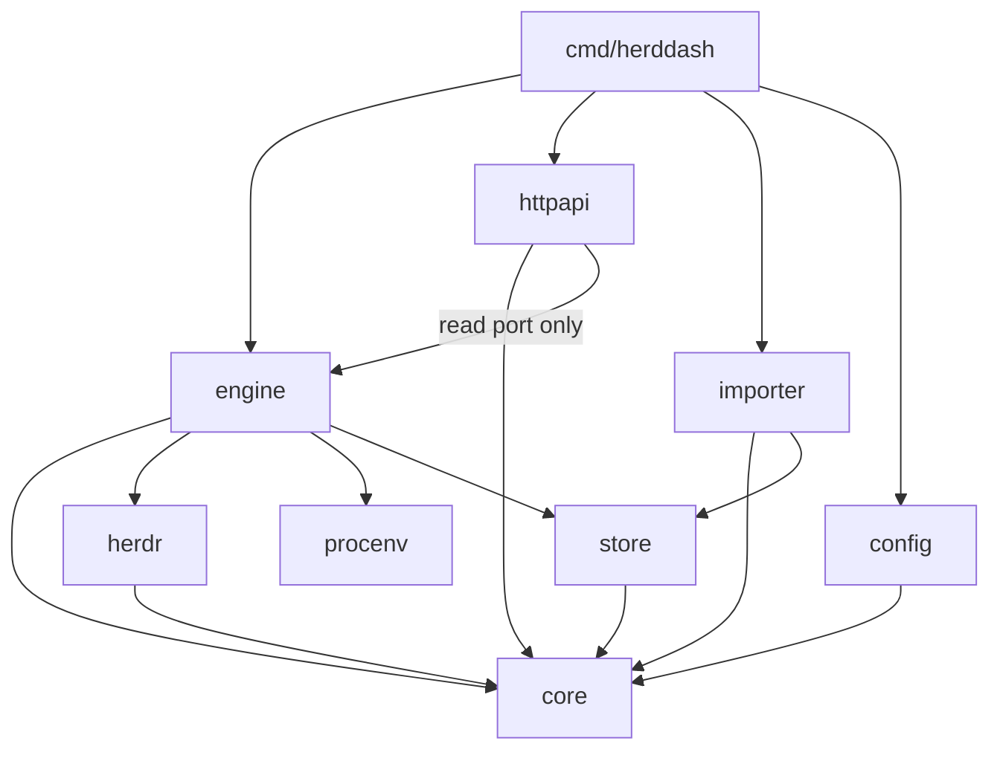
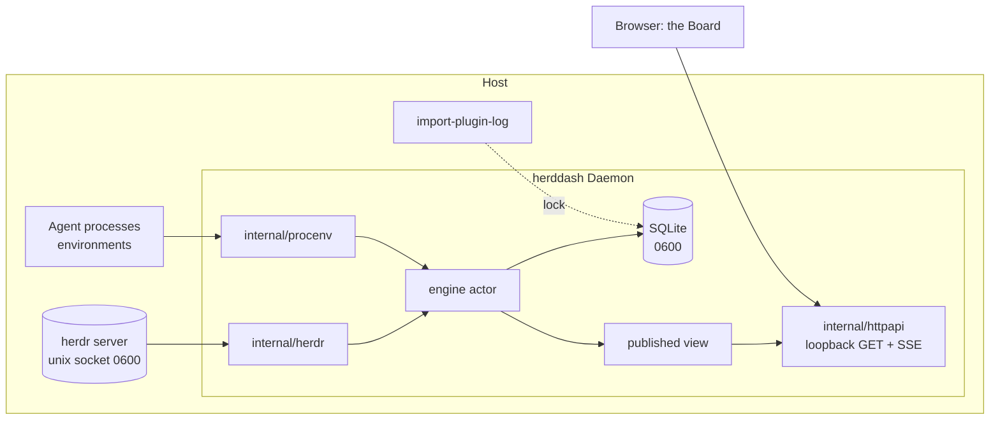
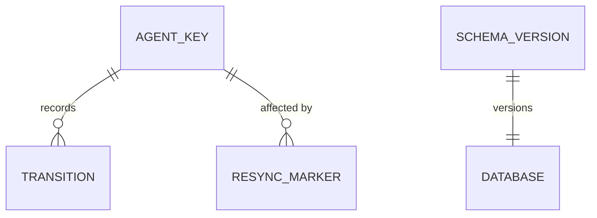

# Architecture Spine — herddash

Vocabulary is the PRD's §3 Glossary, used exactly. Structural decisions that meet the ADR threshold
in CONTRIBUTING.md are numbered ADRs; an `AD` here cites the ADR, and the ADR is the authority.

## Design Paradigm

**Hexagonal, with one actor.** A pure **core** holds every domain rule and does no I/O. **Adapters**
touch the outside world: the herdr socket, the operating system's process environments, SQLite,
HTTP, and the plugin log. One **engine** goroutine sits between them as the only owner of current
state and the only writer of the record.

| Layer | Package | Holds |
| --- | --- | --- |
| Core | `internal/core` | Agent, Transition, AgentKey, Status, Attention Class, Waiting Time, ordering, Profile rules, Context Line rules, AgentView |
| Engine | `internal/engine` | the actor: current state, applying events and snapshots, resync, publishing views |
| Adapter | `internal/herdr` | socket client, subscriptions, snapshot, generated wire types |
| Adapter | `internal/procenv` | reading a process's environment from the OS |
| Adapter | `internal/store` | SQLite schema, migrations, append, Retention sweep, history reads |
| Adapter | `internal/httpapi` | GET routes, SSE, embedded Board assets |
| Adapter | `internal/importer` | plugin-log parsing for FR-9a |
| Wiring | `internal/config`, `cmd/herddash` | TOML config, flags, process lifecycle, subcommands |

## Invariants & Rules



Arrows are the only permitted import directions. `core` imports nothing outside the standard
library.

### AD-1 — Core is pure; every derived value is computed once, there

- **Binds:** FR-2, FR-2a, FR-3, FR-10, FR-12, FR-13
- **Prevents:** the Board, the API and a future surface each deriving Attention Class, Waiting Time,
  Profile, Context Line or order slightly differently.
- **Rule:** Attention Class, Waiting Time and its lower-bound flag, Profile, Context Line and Box
  order are functions in `internal/core`, taking state and a clock. They produce one `AgentView`
  type. `/api/state` and every SSE event carry `AgentView` verbatim. The Board renders it and
  computes nothing, except advancing the displayed Waiting Time from the view's start instant
  between events.

### AD-2 — One writer: the engine actor [ADOPTED]

- **Binds:** FR-4, FR-6, FR-7, FR-8, FR-9, FR-9a
- **Prevents:** two goroutines mutating current state or writing transitions, and so two orders
  of truth.
- **Rule:** current state lives only inside the engine goroutine. The herdr client, the
  reconcile and Retention timers, and Profile re-resolution send it messages, and it alone calls
  `store` writes. After each change it publishes an immutable view (current `AgentView`s, the
  connection truth and a view sequence number); readers take that view and never lock engine
  state. The FR-9a import runs only while no Daemon holds the database (AD-9).

### AD-3 — Agent identity is (Host, herdr server, pane id) [ADOPTED]

- **Binds:** FR-6, FR-12, FR-14, PRD §5 (multi-Host later)
- **Prevents:** pane id collisions across machines or named sessions, and a later aggregation that
  needs a schema change.
- **Rule:** `AgentKey{Host, Server, PaneID}` is the identity everywhere: store rows, `AgentView`,
  API paths (`/api/agents/{host}/{server}/{pane}/history`), SSE events. Host is the configured
  name, defaulting to the OS hostname. Server is the herdr session name: `default` for
  `~/.config/herdr/herdr.sock`, and `<name>` for `sessions/<name>/herdr.sock`. Nothing is keyed by
  pane id alone.

### AD-4 — The record is append-only — ADR-0005

- **Binds:** FR-6, FR-7, FR-8, FR-9, FR-9a, FR-11, FR-14
- **Prevents:** history being rewritten by a Profile Map edit, a resync or an import, and
  provenance being lost.
- **Rule:** transitions and resync markers are inserted, never updated. Only the Retention sweep
  deletes. Each transition stores the AgentKey, Agent Program, Profile as resolved then, previous
  and new Status, herdr ordering where known, herdr version, provenance (`live`, `snapshot` or
  `backfill`), a possibly-spurious flag, and `observed_at`. The table shape is ADR-0005.

### AD-5 — herdr is reached only through `internal/herdr` — ADR-0006

- **Binds:** FR-6, FR-7, FR-8, FR-16, PRD §5 never-focus and never-read-output rules
- **Prevents:** a second socket client, a pooled or multiplexed connection, a focus call, or an
  output read creeping in from another package.
- **Rule:** only `internal/herdr` opens the socket. It dials one connection per request and holds
  one long-lived connection per subscription. It subscribes before snapshotting, treats the
  snapshot as truth and events as invalidation, reconciles on a timer, and runs at most one resync
  at a time. Its API has **no** focus method and **no** pane-output method in v1. The capability is
  absent, not merely unused. Wire types are generated from `herdr api schema --json`. The protocol
  rules are ADR-0006.

### AD-6 — The HTTP surface is read-only and never calls herdr — ADR-0007

- **Binds:** FR-12, FR-13, FR-14, FR-17, PRD §4.4 NFRs
- **Prevents:** a write route, an on-demand herdr call per page view, or a second network surface.
- **Rule:** one loopback listener serves only GET: `/`, `/api/state`,
  `/api/agents/{host}/{server}/{pane}/history`, and `/events`. Every response is built from the
  engine's published view or a `store` read. The listener and its defaults are ADR-0007.

### AD-7 — SSE has no replay; clients resync by refetching

- **Binds:** FR-4, FR-5, FR-13
- **Prevents:** a server-side event buffer whose semantics drift from `/api/state`, and clients
  that apply stale events after a reconnect.
- **Rule:** every published view carries a monotonically increasing sequence number. An SSE event
  is a whole `AgentView`, a removal of one AgentKey, or the connection truth, stamped with that
  sequence number. On every connect and reconnect the client fetches `/api/state` first, then
  applies only events with a higher sequence number. The server keeps no event history.

### AD-8 — Configuration is one TOML file, read at start — ADR-0004

- **Binds:** FR-11, FR-15
- **Prevents:** settings scattered across flags, environment variables and files, and live
  reloads that leave half-applied Profile rules.
- **Rule:** `internal/config` parses one TOML file into one immutable struct. It validates the
  struct at start, fails fast on error, and changes take effect only on restart. Precedence is
  fixed: a command-line flag beats the file, which beats the defaults. The socket path, when not
  configured, follows herdr's own resolution order (`--session`, `HERDR_SOCKET_PATH`,
  `HERDR_SESSION`, then the default session).

### AD-9 — One process owns the database at a time

- **Binds:** FR-9a, FR-15, FR-17
- **Prevents:** the importer and a running Daemon writing concurrently, and two Daemons sharing a
  database.
- **Rule:** the Daemon takes an exclusive lock file beside the database at start and holds it
  until exit. `herddash import-plugin-log` takes the same lock and refuses to run while it is
  held. The data directory is created `0700`; the database, its lock and the log are `0600`.

### AD-10 — Schema changes are numbered migrations, and the event schema needs an ADR

- **Binds:** FR-6, FR-8, FR-9
- **Prevents:** a hand-altered database, or a stored-event change that silently breaks history
  reads.
- **Rule:** migrations are embedded, numbered SQL files, applied in order at start inside one
  transaction. The schema version is recorded in the database. A migration that touches the
  transitions table is a stored-event-schema change and needs an ADR first (CONTRIBUTING).

## Consistency Conventions

| Concern | Convention |
| --- | --- |
| Naming | PRD §3 terms become Go identifiers verbatim: `Agent`, `Transition`, `Profile`, `AttentionClass`, `WaitingTime`, `ContextLine`, `AgentKey`, `AgentView`. herdr wire names stay in `internal/herdr` and are mapped at its edge. |
| Time | Stored and transmitted as UTC Unix milliseconds. `observed_at` is the Daemon's clock. Order within one Agent is herdr's sequence when known, else `observed_at`. |
| Status values | herdr's strings verbatim: `working`, `blocked`, `done`, `idle`, `unknown`. Attention Class values: `needs_you`, `finished`, `working`, `unknown`. |
| JSON | `snake_case` fields. Errors are `{"error": {"code": "...", "message": "..."}}` with a matching HTTP status. Absent values are omitted, never empty strings, except an empty Context Line, which is `""` by FR-2a. |
| SSE | Event names `agent`, `removed` and `connection`; `id:` is the view sequence number; `data:` is one JSON object. |
| Errors | Adapters wrap with `%w` and context; core returns typed errors. herdr error codes are an open set: an unknown code from a subscription triggers a resync, never a crash. |
| Logging | `log/slog`, JSON to the log file, owner-only. Never log environment values beyond the matched `CLAUDE_CONFIG_DIR`, and never log the Pane Title at levels above debug. |
| Clock | Every time-dependent core function takes the clock as a parameter; no `time.Now()` inside `core`. |
| Tests | Core is table-tested with no I/O. Adapters are tested against fakes or temporary files; nothing in `go test ./...` touches a live herdr. |

## Stack

| Name | Version |
| --- | --- |
| Go (go.mod `go` directive) | 1.26 |
| Go toolchain for releases | 1.27.2 |
| modernc.org/sqlite | v1.60.1 |
| github.com/BurntSushi/toml | v1.6.0 |
| HTTP, SSE, embedding, logging | Go standard library (`net/http`, `embed`, `log/slog`) |
| Board | hand-written HTML, CSS and JavaScript, embedded; no npm, no build step |
| herdr supported | 0.9.2 or newer (latest 0.9.4); 0.8.2 only behind FR-16's dogfooding flag |

## Structural Seed





```text
cmd/herddash/          # main: serve (default), import-plugin-log, version
internal/core/         # pure domain rules and AgentView
internal/engine/       # the single-writer actor
internal/herdr/        # socket client; gen/ holds generated wire types
internal/procenv/      # process environment readers, per OS (linux, darwin)
internal/store/        # SQLite; migrations/ holds numbered .sql files
internal/httpapi/      # routes, SSE; web/ holds embedded Board assets
internal/importer/     # plugin-log parser
internal/config/       # TOML config and validation
```

**Deployment.** One binary per OS and architecture (darwin/arm64, darwin/amd64, linux/amd64,
linux/arm64), run as the operator's own user on each Host. During dogfooding it is started by hand.
A launchd agent and a systemd user unit come with the first release; they set no
`HERDR_SOCKET_PATH`, which AD-8 covers. No container, no root, no system service.

## Capability → Architecture Map

| Capability | Lives in | Governed by |
| --- | --- | --- |
| FR-1 to FR-5 Board | `internal/httpapi/web`, `internal/core` (AgentView, order) | AD-1, AD-6, AD-7 |
| FR-6 to FR-8 Recording | `internal/engine`, `internal/herdr`, `internal/store` | AD-2, AD-4, AD-5 |
| FR-9 Retention | `internal/engine` timer, `internal/store` sweep | AD-2, AD-4 |
| FR-9a Backfill | `internal/importer`, `cmd/herddash` | AD-4, AD-9 |
| FR-10, FR-11 Attribution | `internal/core` rules, `internal/procenv`, `internal/config` | AD-1, AD-8 |
| FR-12 to FR-14 API | `internal/httpapi`, `internal/store` reads | AD-6, AD-7, AD-3 |
| FR-15 Binary and config | `cmd/herddash`, `internal/config` | AD-8 |
| FR-16 Version gate | `internal/herdr` (ping), `internal/engine` | AD-5 |
| FR-17 Loopback, owner-only | `internal/httpapi`, `internal/store` | AD-6, AD-9 |

## Deferred

- **The exact transitions table columns and indexes.** ADR-0005 fixes them in milestone 2, once
  the 0.9.x schema dump shows which herdr ordering fields exist.
- **Generated wire types.** They come from `herdr api schema --json` against a 0.9.2-or-newer
  binary in milestone 1. Until then, field names in the research are provisional.
- **Profile rules for Codex and Antigravity.** The rule interface is fixed by AD-1; the rules wait
  on observing a pane of each (PRD open question 3).
- **The acknowledgement set.** If PRD open question 1 calls for it, it is engine state persisted
  through `store` beside a server generation marker. Its table waits on that decision.
- **Authentication and non-loopback binding.** A future ADR; AD-6 and FR-17 refuse it until then.
- **Multi-Host aggregation.** It reads several Daemons' APIs and needs no change to the core,
  because AD-3 already keys on Host.
- **Service unit files and release packaging.** Milestone 5; nothing here constrains them beyond
  the Deployment note.
- **Board visual design.** Colours, typography and card layout are UX work; the spine fixes only
  that the Board renders `AgentView` and computes nothing.
